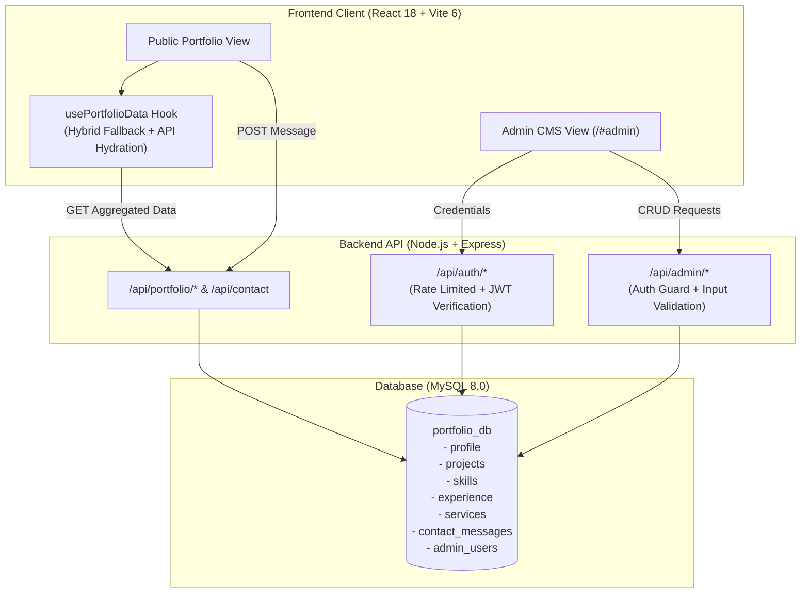

# Hassaan Ali Akbar — Dynamic Developer Portfolio & Admin CMS (Week 12 Final Submission)

A high-performance, dynamic full-stack developer portfolio and administrative Content Management System engineered with **React 18**, **Vite 6**, **Tailwind CSS**, **Framer Motion**, **GSAP**, **Three.js**, **Node.js**, **Express.js**, and **MySQL 8.0**.

---

## 1. Project Overview

This repository contains the complete source code for **Hassaan Ali Akbar's Personal Dynamic Portfolio Website & Admin CMS**. Built for Week 12 of the engineering internship, the application transforms a static showcase into a data-driven portfolio powered by a normalized relational database, hybrid client hydration, and an administrative CMS.

- **Developer**: Hassaan Ali Akbar — Full-Stack Developer
- **Role & Specialization**: Building responsive, resilient, accessible full-stack digital web applications
- **Primary Objectives**:
  - Present production projects, architecture case studies, engineering services, and verifiable work history.
  - Provide an interactive 3D Solar System skill orbit built with Three.js.
  - Implement a secure, rate-limited administrative CMS for dynamic live updates without code redeployments.
  - Ensure fast load times through a hybrid hydration layer (`usePortfolioData`) that renders static fallback data offline and seamlessly reconciles with MySQL 8.0.

---

## 2. Technology Stack

### Frontend
- **React 18** (`^18.3.1`): Component-driven user interface architecture.
- **Vite 6** (`^6.4.3`): Next-generation ES module frontend build tooling and dev server.
- **Tailwind CSS** (`^3.4.19`): Utility-first responsive styling with custom dark theme tokens.
- **Three.js** (`^0.185.1`): 3D canvas rendering for the interactive Solar System TechStack galaxy.
- **Framer Motion** (`^13.1.1`): Declarative UI animations, layout transitions, and modal choreographies.
- **GSAP** (`^3.15.0`): High-performance timeline animations for smooth interactions.
- **Lucide React** (`^0.469.0`): Clean icon set mapped dynamically to services and technologies.

### Backend
- **Node.js**: Modern JavaScript runtime (ES Modules).
- **Express.js** (`^4.21.2`): Minimalist web framework hosting the REST API endpoints.
- **MySQL 8.0** via **mysql2** (`^3.16.2`): Relational data storage with connection pooling and parameterized queries.
- **JSON Web Tokens (jsonwebtoken)** (`^9.0.3`): Signed JWT tokens for authenticated administrative sessions.
- **Bcrypt.js** (`^3.0.3`): Adaptive cryptographic password hashing with 12 salt rounds.
- **Multer** (`^2.4.0`): Secure multipart/form-data handler for resume PDF uploads.
- **Express-Rate-Limit** (`^7.5.0`): Endpoint rate limiting to protect against abuse and credential stuffing.
- **Helmet** (`^8.1.0`): HTTP security header configuration.
- **CORS** (`^2.8.6`): Cross-Origin Resource Sharing control.
- **Dotenv** (`^17.3.1`): Environment variable management.

---

## 3. Main Features

### Public Portfolio
1. **Hero Section**:
   - Continuous moving background name marquee with right-to-left seamless animation.
   - Foreground portrait cutout layered in front of the animated marquee.
   - Balanced, compact mobile hero with shoulder-aligned name coverage and zero vertical clipping.
   - Status indicators (`Open for Opportunities`, `Based in Lahore, Pakistan`).
   - Dynamic CTA buttons (`View Projects`, `Resume`, `Contact`).
2. **Interactive 3D TechStack**:
   - 21 skills positioned across 6 orbital rings around a core star using Three.js.
   - Interactive orbit controls: pause/resume rotation, speed slider, zoom controls.
   - Accessible 2D Grid view toggle with categorized skill pill filters.
3. **Projects Showcase & Case Studies**:
   - 6 showcase projects with live category filters (`All`, `Full-Stack`, `Real-Time`, `CMS / SaaS`, `Management`, `Data / Monitoring`).
   - Deep-dive case study modal views featuring architectural overviews, key challenges, engineering decisions, and live links.
4. **Services Showcase**:
   - Full-stack engineering service cards with dynamic Lucide icon mappings and interactive hover states.
5. **Work Experience & Education Timeline**:
   - Structured timeline displaying professional roles, company names, date ranges, and relevant skill tags.
6. **Lead Generation Contact Form**:
   - Client-side input validation, rate limiting, and persistence to the MySQL `contact_messages` database table.
7. **Resume Functionality**:
   - Dedicated resume download button dynamically serving the latest uploaded resume or fallback document.
8. **Hybrid Hydration Resilience**:
   - The `usePortfolioData` hook ensures instantaneous rendering using static fallback data, seamlessly updating with live data once the backend API responds.

### Admin CMS Dashboard (`/#admin`)
1. **Secure Authentication**:
   - Dedicated login route with rate limiting, lockout safeguards, and secure `httpOnly` session cookies.
   - One-time initial admin setup wizard with permanent lock after first initialization.
2. **Overview Statistics**:
   - Real-time counters for projects, skills, experience entries, services, and unread contact messages.
3. **Profile Management**:
   - Live updates for headline, bio, role title, location, status badge, and social URLs.
   - Built-in PDF resume upload tool with file validation.
4. **Projects Management**:
   - Full CRUD: add new projects, edit case studies, reorder entries, and toggle featured flags.
5. **Skills Management**:
   - Full CRUD: manage skill names, categories, orbital radii, speeds, and color codes for the 3D canvas.
6. **Experience Management**:
   - Full CRUD: manage work history and education records.
7. **Services Management**:
   - Full CRUD: configure service titles, descriptions, and icon mappings.
8. **Messages Inbox**:
   - View contact submissions, toggle read/unread status, and delete messages.
9. **Account Settings**:
   - Secure in-CMS administrator email and password updates requiring current password confirmation.

---

## 4. Architecture



- **Frontend**: Single-page application router rendering the public portfolio by default and the Admin CMS when accessing the `/#admin` hash route.
- **Backend**: Express REST API exposing public read endpoints, contact ingestion, and protected admin endpoints guarded by JWT cookie authentication.
- **Database**: 7 normalized relational tables in MySQL 8.0 with foreign keys, indexes, and full parameterized query protection.

---

## 5. Installation and Setup

### Prerequisites
- **Node.js**: `v18.0.0` or higher
- **npm**: `v9.0.0` or higher
- **MySQL Server**: `v8.0` or higher running on `127.0.0.1:3306`

### Step 1: Clone the Repository
```bash
git clone https://github.com/hassaanrana07/Personal-Portfolio-Website.git
cd Personal-Portfolio-Website
```

### Step 2: Install Dependencies
```bash
# Install frontend dependencies
npm install

# Install backend dependencies
cd server
npm install
cd ..
```

### Step 3: Configure Environment Variables
Create the backend configuration file `server/.env`:
```bash
cp server/.env.example server/.env
```
*(Optionally create a root `.env` if configuring a custom `VITE_API_BASE_URL`)*

### Step 4: Configure and Initialize MySQL Database
Ensure MySQL is running, then create the database:
```sql
CREATE DATABASE portfolio_db CHARACTER SET utf8mb4 COLLATE utf8mb4_unicode_ci;
```

Run migrations and seed the database with initial portfolio data:
```bash
# Run migrations (creates 7 normalized tables)
npm run db:migrate --prefix server

# Seed initial showcase portfolio dataset
npm run db:seed --prefix server
```

### Step 5: Configure Administrator Account
Choose one of the following methods to initialize your admin credentials:

#### Option A: Web Browser Setup (Recommended)
1. Start the application (Step 6).
2. Visit `http://localhost:3000/#admin`.
3. Fill in your name, email, and password in the one-time setup form.

#### Option B: Terminal Setup Script
```bash
npm run admin:setup --prefix server
```

### Step 6: Start Development Servers
Open two terminal windows:

**Terminal 1 — Backend API:**
```bash
cd server
npm start
```
*Backend runs on `http://localhost:5000`*

**Terminal 2 — Frontend Client:**
```bash
npm run dev
```
*Frontend runs on `http://localhost:3000`*

---

## 6. Environment Variables

### Backend (`server/.env`)
```env
PORT=5000
NODE_ENV=development
CLIENT_URL=http://localhost:3000

# MySQL 8 Database Configuration
DB_HOST=127.0.0.1
DB_PORT=3306
DB_USER=root
DB_PASSWORD=your_mysql_password
DB_NAME=portfolio_db

# Security & Authentication
JWT_SECRET=your_secure_random_jwt_secret_key_minimum_32_characters
JWT_EXPIRES_IN=24h

# Configurable Rate Limiting
RATE_LIMIT_PUBLIC_WINDOW_MS=900000
RATE_LIMIT_PUBLIC_MAX=300
RATE_LIMIT_CONTACT_WINDOW_MS=3600000
RATE_LIMIT_CONTACT_MAX=15
RATE_LIMIT_ADMIN_WINDOW_MS=900000
RATE_LIMIT_ADMIN_MAX=1000
RATE_LIMIT_AUTH_WINDOW_MS=900000
RATE_LIMIT_AUTH_MAX_IP=20
RATE_LIMIT_AUTH_MAX_ACCOUNT=5
```

### Frontend (`.env`)
```env
VITE_API_BASE_URL=http://localhost:5000
```

> [!CAUTION]
> Never commit actual passwords, API secrets, or private keys to source control. Ensure `.env` files are excluded by `.gitignore`.

---

## 7. Project Structure

```
Personal-Portfolio-Website/
├── public/                     # Static assets served at root
│   ├── assets/                 # Calligraphy & identity logos
│   └── Hassaan Ali Akbar Resume.pdf # Default fallback resume
├── server/                     # Express.js & MySQL backend
│   ├── config/
│   │   ├── database.js         # MySQL connection pool
│   │   └── security.js         # Security headers & rate limiters
│   ├── middleware/
│   │   ├── auth.js             # JWT authentication guard
│   │   └── validator.js        # Strict input validation schemas
│   ├── routes/
│   │   ├── admin.js            # Protected administrative CRUD routes
│   │   ├── auth.js             # Authentication & setup routes
│   │   └── public.js           # Public portfolio & contact routes
│   ├── scripts/
│   │   ├── migrate.js          # Database schema migrations
│   │   ├── seed.js             # Database seeding script
│   │   ├── setup-admin.js      # Headless admin account CLI tool
│   │   └── test-*.js           # Automated test suites
│   ├── uploads/                # Dynamic uploaded resumes (gitignored)
│   ├── server.js               # Express application entrypoint
│   └── package.json            # Backend dependencies & scripts
├── src/                        # React frontend application
│   ├── assets/                 # Images & local graphic assets
│   ├── components/
│   │   ├── admin/              # Admin CMS tabs & modal editors
│   │   ├── About.jsx           # About biography section
│   │   ├── Contact.jsx         # Contact form with validation
│   │   ├── Experience.jsx      # Work history timeline
│   │   ├── Hero.jsx            # Responsive hero with moving marquee
│   │   ├── LoadingScreen.jsx   # Clamped 0-100% loading progress
│   │   ├── Navbar.jsx          # Capsule navigation with Urdu logo
│   │   ├── Projects.jsx        # Project grid & case studies
│   │   ├── Services.jsx        # Engineering services cards
│   │   └── TechStack.jsx       # 3D Solar System & 2D grid toggle
│   ├── hooks/
│   │   └── usePortfolioData.js # Hybrid hydration data layer
│   ├── data/
│   │   └── staticData.js       # Offline fallback dataset
│   ├── App.jsx                 # Application root & hash routing
│   ├── index.css               # Tailwind & custom keyframe styling
│   └── main.jsx                # React DOM entrypoint
├── index.html                  # HTML entrypoint
├── package.json                # Frontend dependencies & scripts
├── tailwind.config.js          # Tailwind theme tokens & fonts
└── vite.config.js              # Vite bundler configuration
```

---

## 8. API Documentation

### Public Endpoints
| Method | Endpoint | Description |
| :--- | :--- | :--- |
| `GET` | `/api/portfolio/all` | Fetch aggregate data (profile, projects, skills, experience, services) |
| `GET` | `/api/profile` | Fetch profile identity and status |
| `GET` | `/api/projects` | Fetch all active projects |
| `GET` | `/api/projects/:id` | Fetch specific project details |
| `GET` | `/api/skills` | Fetch all skills with 3D orbit parameters |
| `GET` | `/api/experience` | Fetch work and education history |
| `GET` | `/api/services` | Fetch engineering service offerings |
| `POST` | `/api/contact` | Submit a contact form message (rate limited, validated) |

### Authentication Endpoints
| Method | Endpoint | Description |
| :--- | :--- | :--- |
| `POST` | `/api/auth/login` | Authenticate administrator, set `httpOnly` JWT session cookie |
| `POST` | `/api/auth/logout` | Clear session cookie |
| `GET` | `/api/auth/check` | Verify current session validity |
| `POST` | `/api/auth/setup` | One-time initial admin registration (permanently locks after use) |

### Protected Admin Endpoints (Requires Valid Admin Cookie)
| Method | Endpoint | Description |
| :--- | :--- | :--- |
| `GET` | `/api/admin/overview` | Fetch count statistics and message counters |
| `PUT` | `/api/admin/profile` | Update profile details and social links |
| `POST` | `/api/admin/resume` | Upload new PDF resume (multipart/form-data) |
| `PUT` | `/api/admin/account` | Update admin email and password |
| `POST` | `/api/admin/projects` | Create a new project |
| `PUT` | `/api/admin/projects/:id` | Update project or case study |
| `DELETE` | `/api/admin/projects/:id` | Delete a project |
| `POST` | `/api/admin/projects/reorder` | Update project display order |
| `POST` | `/api/admin/skills` | Add a skill with 3D orbital parameters |
| `PUT` | `/api/admin/skills/:id` | Update a skill |
| `DELETE` | `/api/admin/skills/:id` | Delete a skill |
| `POST` | `/api/admin/experience` | Add work/education history entry |
| `PUT` | `/api/admin/experience/:id` | Update work/education entry |
| `DELETE` | `/api/admin/experience/:id` | Delete work/education entry |
| `POST` | `/api/admin/services` | Add a service offering |
| `PUT` | `/api/admin/services/:id` | Update a service offering |
| `DELETE` | `/api/admin/services/:id` | Delete a service offering |
| `GET` | `/api/admin/messages` | View all contact submissions |
| `PATCH` | `/api/admin/messages/:id/read` | Toggle message read status |
| `DELETE` | `/api/admin/messages/:id` | Delete contact submission |

---

## 9. Build and Testing

### Frontend Production Build
```bash
# Build production bundle with Vite
npm run build

# Preview production build locally
npm run preview
```

### Automated Regression & QA Test Suites
Run the automated verification scripts against the running backend:
```bash
# Comprehensive Hero & mobile responsiveness test (49 viewport assertions)
node server/scripts/test-hero-responsiveness.js

# Full public & admin API integration suite
node server/scripts/test-api.js

# Security audit (rate limiting, auth guards, input validation)
node server/scripts/test-security-audit.js

# Admin setup & credential verification
node server/scripts/test-admin-setup.js

# Frontend hybrid hydration test
node server/scripts/test-hydration-hook.js

# Contact form persistence test
node server/scripts/test-contact.js

# CMS live mutation propagation test
node server/scripts/test-cms-propagation.js
```

---

## 10. Author Information

**Hassaan Ali Akbar**  
*Full-Stack Developer*  
Lahore, Pakistan

- **Email**: [hassaanalee07@gmail.com](mailto:hassaanalee07@gmail.com)
- **GitHub**: [@hassaanrana07](https://github.com/hassaanrana07)
- **LinkedIn**: [hassaanaliakbar](https://linkedin.com/in/hassaanaliakbar)
- **Instagram**: [@hassaanaleerana](https://www.instagram.com/hassaanaleerana/)
