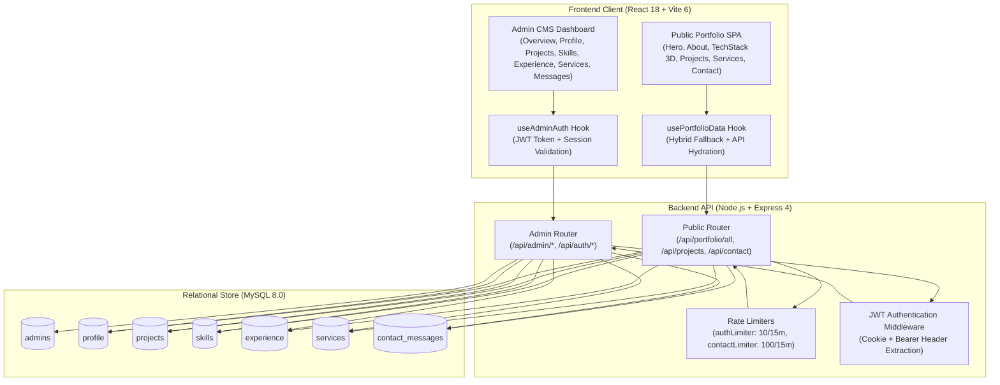

# System Architecture & Technical Specification

**Project**: Dynamic Developer Portfolio & Admin CMS (Portfolio 2.0)  
**Author**: Hassaan Ali Akbar  
**Role**: Full-Stack Web Developer  
**Date**: October 9, 2026  
**Version**: 2.0.0 (Production Release)

---

## 1. System Overview

The system is architected as a decoupled, full-stack web application designed for high responsiveness, SEO performance, data resilience, and continuous administrative control. It bridges a modern single-page React frontend with a lightweight Node.js/Express API layer and a structured MySQL 8.0 relational database.



---

## 2. Layered Architecture

### 2.1 Frontend Layer (React + Vite + Tailwind CSS)
- **Framework**: React 18.3.1 with Vite 6.4.3 bundler for sub-second HMR and optimized production asset chunking.
- **Styling**: Tailwind CSS 3.4.19 with a custom dark editorial theme (`#0f0f0f` canvas, `#161616` cards, `#f2f2f0` typography, `#FF9A3D` amber accent).
- **3D Graphics**: Three.js rendering an interactive Solar System model with orbital calculation loops (`radius`, `speed`), mesh glowing materials, and responsive resize observers.
- **State & Data Hydration**: Centralized in [`src/hooks/usePortfolioData.js`](file:///e:/Hassaan/My%20Projects/portfolio%202/src/hooks/usePortfolioData.js). It initializes the UI instantaneously using structured static fallbacks, then queries `/api/portfolio/all` in the background, smoothly re-hydrating the state with MySQL records.

### 2.2 Backend Layer (Node.js + Express)
- **Framework**: Express 4.21.2 with ES Modules (`type: "module"`).
- **Security Middleware**:
  - `helmet`: Sets HTTP security headers including X-Content-Type-Options, X-Frame-Options, and Referrer-Policy.
  - `cors`: Strict origin validation against `CLIENT_URL` with credentials support.
  - `express-rate-limit`: Protects sensitive routes against brute-force attacks (`authLimiter`: 10 req / 15m; `contactLimiter`: 100 req / 15m).
  - `authenticateAdmin`: Extracts and verifies JWT from both `admin_session` HTTP-only cookies and `Authorization: Bearer <token>` headers.
- **Routing Structure**:
  - `server/routes/public.js`: High-throughput public read endpoints and contact submission.
  - `server/routes/auth.js`: Admin login, logout, and `/api/auth/me` session validation.
  - `server/routes/admin.js`: Protected administrative CRUD operations.

### 2.3 Database Layer (MySQL 8.0)
- **Connection Pooling**: `mysql2/promise` with configurable pool size (10 connections), keep-alive headers, and automated reconnection handling.
- **Integrity**: 100% parameterized queries (`?`) preventing SQL injection. JSON data types for flexible technologies and case study schemas.

---

## 3. Database Schema & Relational Model

```mermaid
erDiagram
    admins {
        VARCHAR(36) id PK
        VARCHAR(255) email UK
        VARCHAR(255) password_hash
        VARCHAR(150) name
        TIMESTAMP created_at
        DATETIME last_login_at
    }

    profile {
        VARCHAR(36) id PK
        VARCHAR(150) full_name
        VARCHAR(150) title
        TEXT tagline
        TEXT bio
        VARCHAR(100) location
        VARCHAR(255) email
        VARCHAR(50) phone
        VARCHAR(100) status_text
        VARCHAR(50) status_badge
        VARCHAR(255) github_url
        VARCHAR(255) linkedin_url
        VARCHAR(255) instagram_url
        VARCHAR(255) resume_url
        TIMESTAMP updated_at
    }

    projects {
        VARCHAR(36) id PK
        VARCHAR(100) slug UK
        VARCHAR(10) number
        VARCHAR(150) name
        VARCHAR(255) subtitle
        VARCHAR(100) category
        VARCHAR(100) project_type
        VARCHAR(100) role
        VARCHAR(20) accent_color
        BOOLEAN is_featured
        INT sort_order
        VARCHAR(500) image_url
        TEXT description
        JSON technologies
        VARCHAR(500) github_url
        VARCHAR(500) live_url
        VARCHAR(500) preview_type
        JSON case_study
        TIMESTAMP created_at
        TIMESTAMP updated_at
    }

    skills {
        VARCHAR(36) id PK
        VARCHAR(100) category
        VARCHAR(100) name
        VARCHAR(20) color_hex
        TEXT description
        VARCHAR(500) logo_url
        DECIMAL(4,1) orbit_radius
        DECIMAL(6,4) orbit_speed
        INT sort_order
    }

    experience {
        VARCHAR(36) id PK
        ENUM type
        VARCHAR(100) period
        VARCHAR(150) role
        VARCHAR(150) organization
        VARCHAR(100) location
        TEXT description
        JSON tags
        VARCHAR(20) color_theme
        INT sort_order
    }

    services {
        VARCHAR(36) id PK
        VARCHAR(150) title
        TEXT short_desc
        TEXT full_desc
        VARCHAR(50) icon_name
        INT sort_order
    }

    contact_messages {
        VARCHAR(36) id PK
        VARCHAR(150) name
        VARCHAR(255) email
        VARCHAR(255) subject
        TEXT message
        VARCHAR(45) ip_address
        BOOLEAN is_read
        TIMESTAMP created_at
    }
```

---

## 4. Key Data Flows

### 4.1 Hybrid Public Hydration Flow
1. User loads `http://localhost:3000`.
2. React mounts `App.jsx`, invoking `usePortfolioData()`.
3. `usePortfolioData()` immediately hydrates components using local static fallback objects.
4. An asynchronous fetch dispatches to `GET /api/portfolio/all`.
5. Express queries `profile`, `projects`, `skills`, `experience`, and `services` tables in parallel via `pool.query()`.
6. Normalizer functions parse JSON fields and harmonize property naming (`is_featured` -> `isFeatured`).
7. React state updates smoothly without layout shift or UI flickering.

### 4.2 Lead Submission Flow
1. Visitor fills out the Contact form in `Contact.jsx`.
2. Client-side validation checks length, required fields, and email regex.
3. Form issues `POST /api/contact`.
4. `contactLimiter` verifies client IP has not exceeded 100 requests in 15 minutes.
5. Controller sanitizes and validates inputs.
6. Parameterized SQL inserts the record into `contact_messages` with `is_read = false`.
7. Client receives HTTP 201 with confirmation message and triggers an in-app toast notification.

### 4.3 Administrative CMS Mutation Flow
1. Admin enters credentials at `/#admin`.
2. `POST /api/auth/login` verifies bcrypt hash ($2b$12$) and signs a 24-hour JWT token.
3. Server returns JWT and sets `admin_session` HTTP-only cookie.
4. Admin edits a project, skill, or profile value and clicks "Save".
5. `adminApi` dispatches authenticated `PUT`/`POST` to `/api/admin/*`.
6. Database commits the change within a transaction.
7. Admin toast confirms success; subsequent public API calls reflect the modified data in real time.
